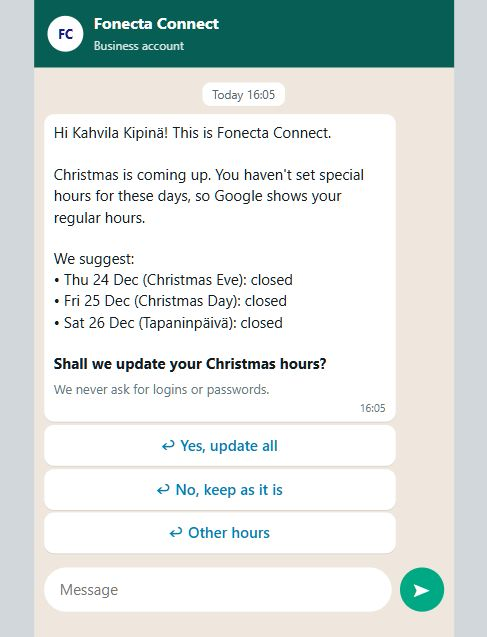

# Fonecta Connect | School of Business

**Connect Suggests, Customer Approves · Fonecta challenge · Since AI 2026**

**Keep businesses up to date, even when owners don’t answer messages.** Our assistant identifies opening hours that need attention and contacts the owner with a ready-made suggestion. When an important request goes unanswered, an AI voice agent follows up by phone, confirms the right hours and saves the approved update to Yext. Owners keep working; Connect takes care of the follow-up, because a busy entrepreneur doesn’t have time to answer texts and emails, but still picks up the phone.

**Video:** [Watch the demo](https://youtu.be/jwwFUcyqsgw) · **Pitch deck:** [Fonecta Connect](docs/pitch-deck.pptx) · **Prediction file:** [predictions_2026.csv](predictions_2026.csv)

## Run it

**Before evaluating free-text replies, configure OpenShift AI.** The WhatsApp-style browser demo uses a real OpenShift AI model to interpret natural-language opening-hour replies. Add a valid `OPENSHIFT_AI_TOKEN`, a reachable `OPENSHIFT_AI_URL` and the matching `OPENSHIFT_AI_MODEL` to the repository-root `.env` (copy [.env.example](.env.example) if needed). The model deployment must be running. No WhatsApp delivery credentials are needed for this browser demo.

**Without a working OpenShift connection, the demo still opens, but free-text interpretation is limited.** Buttons, commands such as `UNDO`, and simple edits such as `24 Dec 10-14` work through local rules. More conversational replies may not be understood or may trigger clarification. This fallback does not demonstrate the AI reply reader; configure and check the connection before evaluating that feature.

Check the connection from the repository root:

```sh
python -c "import sys; sys.path.insert(0, 'owner-page'); import hours_ai; print(hours_ai.status())"
```

The result should be **`up`**. **`off`** means the URL or token is missing; **`down`** means the endpoint is not answering successfully (check the token, URL and running deployment). Then run `python owner-page/test_ai_replies.py` to check actual reply interpretation. See [AI reply-reader setup and troubleshooting](owner-page/README.md#how-it-works).

Use **Python 3.12+**, from the repository root:

```sh
python -m pip install -r requirements.txt
python owner-page/app.py
```

Open the **[WhatsApp demo: Kahvila Kipinä](http://localhost:8000/w/FI-D0017/christmas)** (requires the demo to be running locally on your computer). On Windows, use `py -3.12 owner-page/app.py`. The checked-in C13 exports are sufficient; no model training is required at startup. Keep the supplied challenge data and engine outputs in their repository locations.

**The connected services require credentials.** Copy [.env.example](.env.example) to an ignored `.env` if one does not already exist, then configure the services you intend to use:

| Capability | Required configuration | Without it |
|---|---|---|
| Real WhatsApp delivery | Twilio account/token, WhatsApp sender, approved template, opted-in recipient and public HTTPS webhooks. See [messaging setup](owner-page/MESSAGING.md). | The browser preview remains available; no external message is sent. |
| Ticketmaster events | `TICKETMASTER_API_KEY` (Consumer Key). | Ticketmaster is skipped; public city feeds and weather remain available. |
| **OpenShift AI free-text interpretation (required to evaluate conversational replies)** | `OPENSHIFT_AI_URL`, `OPENSHIFT_AI_TOKEN`, `OPENSHIFT_AI_MODEL`, and a running model deployment. | Limited rule-based parsing only; natural-language replies may not be understood. |
| Yext sandbox writes | `YEXT_API_KEY`, `YEXT_BASE_URL`, `YEXT_SANDBOX_MIRROR` for the owner app; `YEXT_SANDBOX_ENTITY_ID` for voice. | The owner demo uses local simulator writes. |
| ElevenLabs browser voice | An accessible `ELEVENLABS_AGENT_ID`; private-agent conversation tokens also require `ELEVENLABS_API_KEY`. | No real voice conversation without an accessible agent. Public agents can connect by ID without a local API key. |
| ElevenLabs outbound calls | `ELEVENLABS_API_KEY`, `ELEVENLABS_AGENT_ID`, `ELEVENLABS_PHONE_NUMBER_ID`, and test destination `DEMO_OWNER_PHONE`. | No outbound phone call. |
| Hosted voice tools and callbacks | Reachable `PUBLIC_BASE_URL`; `ELEVENLABS_WEBHOOK_SECRET` enables post-call signature verification. The supplied launcher uses a working ngrok installation. | Hosted agent tools cannot reach a localhost-only service. |

Public city feeds and Open-Meteo need internet access but do not require keys for this demo.

For live events, weather and a checked Yext sandbox connection:

```sh
python -m pip install -r live_signals/requirements.txt
python -m live_signals.demo --sandbox
```

Omit `--sandbox` for local-only writes. See [live-source setup](live_signals/README.md), [owner app setup](owner-page/README.md) and [Connect Voice setup](Solution/voice/README.md). Voice starts separately and also defaults to port 8000; run the demos sequentially or configure separate ports. To regenerate predictions, follow the [C13 engine instructions](Solution/engine/README.md).

## A two-minute walkthrough

1. Open the [WhatsApp chat for Kahvila Kipinä](http://localhost:8000/w/FI-D0017/christmas) (requires the demo to be running locally on your computer), the customer with no previous hours history or owner decisions.
2. Choose **Yes, update all**, read the confirmation, then reply `UNDO` to restore the previous hours.
3. Reset the chat, choose **Other hours**, and type `24 Dec 10-14`. Only the named day changes.
4. Reset the chat and choose **No, keep as it is**. Existing hours stay unchanged; the owner can also choose whether to receive future suggestions.

Chat reset clears the conversation. Use UNDO to restore hours before resetting.

## The five steps

| Step | What happens |
|---|---|
| **1. Detect** | C13 identifies business/date pairs needing attention. `NO_ACTION` stays quiet; `FLAG` requires review. |
| **2. Suggest** | Exported hours are grouped into a holiday bundle. The owner's history is named only when recorded hours match the proposal. |
| **3. Contact** | WhatsApp through Twilio when configured, plus browser previews for SMS, email and push. ElevenLabs demonstrates voice escalation. |
| **4. Decide** | Approve, edit or decline without a separate login. Owners can type different hours and control future suggestions. |
| **5. Apply and confirm** | Check for intervening changes, write approved hours, read them back, record an audit and confirm. UNDO restores the recorded previous state. |

## Data sources that mattered most

| Signal | How we use it | Production source |
|---|---|---|
| Business entities and hours history | Current schedules, prior exceptions and seasonal patterns; evidence for “last year” wording. | Yext entities and Connect's audit log. |
| Special-day calendar and peer benchmarks | Holiday identity and candidate hours when own history is weak. | Nordic calendars and aggregated Connect history. |
| Reviews and publisher suggestions | Evidence of incorrect hours or possible closure, considered alongside other signals. | Yext Reviews and Publisher Suggestions. |
| Pilot decisions and contact preferences | Owner outcomes, contact eligibility, opt-outs and permissions. | Connect decision logs and CRM. |
| Daily analytics | Historical activity context and prioritization of relevant hours checks. | Yext Analytics reports. |

## Results

**Utility score: 70.92**, the final C13 engine's three-seed mean on grouped 2026 cross-validation. [Evaluation report](Solution/engine/metrics.json).

## What we tried that didn't work

Adding more candidate schedules and training rows did not reliably improve results on held-out businesses. A larger public calendar also failed the earlier-year backtest. We kept the verified C13 model and focused the product on reaching owners and completing approved updates.

## Customer with no history or previous actions

**Kahvila Kipinä (`FI-D0017`)** has no recorded exception-hour history or previous owner decisions. C13 can use calendar and shared patterns; the message says **“We suggest”**. For Christmas, it proposes closure on 24–26 December. The owner can accept, edit individual dates or decline. A missing history never becomes an invented “last year” claim.

## Final customer messages (as text)

The [customer message pack](docs/customer-messages.md) shows the final messages on a phone, including approve, edit and decline. English is the supported demo language. The exact text is also included below.

<a href="docs/customer-messages.md"></a>

<details>
<summary>Exact message text</summary>

**All messages are in English** (team decision), for owners in Finland, Sweden and Norway alike. Holiday names come from the challenge calendar and may appear in the local language. These are the exact messages from the current owner flow.

### Proposal with last year's hours: Kahvila Aurora

The owner set hours for this holiday last year, so the message shows them and offers the same again. The day with no history gets a suggestion, clearly labelled, in the same message. One message covers the whole New Year period.

```text
Hi Kahvila Aurora! This is Fonecta Connect.

New Year is coming up. You haven't set special hours for these days, so Google shows your regular hours.

Last year you were open:
• New Year's Day: closed

We'd use the same hours this year.

For the other days we suggest:
• Wed 6 Jan (Loppiainen): 10–16

Shall we update your New Year hours?

We never ask for logins or passwords.
```

Buttons: **Yes, update all** · **No, keep as it is** · **Other hours**. After **Yes, update all**:

```text
Done ✅ Kahvila Aurora:
• 1 Jan closed
• 6 Jan open 10–16
Your new hours show on Google within minutes, and on 8 other sites soon after.
Wrong? Reply UNDO and we'll put it back.
```

Right after a yes, Connect asks once whether it may handle these hours every year (standing permission). A yes is saved; replying *ASK ME* takes it back at any time.

```text
One more thing: shall we handle your New Year hours for you next year?

We'd set the same hours automatically and send you a message when it's done. You can change your mind anytime by replying ASK ME.
```

Buttons: **Yes, handle it** · **No, ask me first**.

### Proposal for a new customer (no history): Kahvila Kipinä

A new customer has no history, so the message says "We suggest" and never claims "last year".

```text
Hi Kahvila Kipinä! This is Fonecta Connect.

Christmas is coming up. You haven't set special hours for these days, so Google shows your regular hours.

We suggest:
• Thu 24 Dec (Christmas Eve): closed
• Fri 25 Dec (Christmas Day): closed
• Sat 26 Dec (Tapaninpäivä): closed

Shall we update your Christmas hours?

We never ask for logins or passwords.
```

Buttons: **Yes, update all** · **No, keep as it is** · **Other hours**.

### Approval follow-up

```text
Done ✅ Kahvila Kipinä:
• 24 Dec closed
• 25 Dec closed
• 26 Dec closed
Your new hours show on Google within minutes, and on 8 other sites soon after.
Wrong? Reply UNDO and we'll put it back.
```

### Edit follow-up: after `24 Dec 10-14`

```text
Thanks! We saved your hours:
• Thu 24 Dec: open 10–14

The other 2 days stay as they are.

Wrong? Reply UNDO and we'll put it back.
```

### Decline follow-up

```text
OK, we won't change anything. Google keeps showing your regular hours.
If something changes, just reply here.
```

</details>

## Live-source bonus

Live Nordic event feeds replace `local_events.json` at the event-check input, and Open-Meteo replaces `weather_daily.csv` for ski-rental weather checks. Relevant events or fresh snow prompt the owner to confirm listed hours or enter different ones. These sources do not invent a new schedule or change C13's frozen benchmark predictions.

The recorded 7 November audit retrieved **944 event occurrences** across Finland, Sweden and Norway, plus **196 usable city-days across 28 cities**. Coverage is uneven: Helsinki reached its page cap, Oslo's public feed is narrow, and Ticketmaster adds ticketed-event coverage with a key. Forecasts and event listings can expire or change. See [coverage, quality, gaps and attribution](live_signals/README.md#verified-coverage-and-gaps).

## Verification and demo scope

```sh
python -m pip install -r owner-page/requirements-messaging.txt
python -m unittest discover -s owner-page -p "test_*.py"
python -m unittest discover -s step5_apply/tests -t .
python -m unittest live_signals.test_live_signals live_signals.test_checks live_signals.test_demo
```

These checks cover exported decisions, approval/edit/decline, undo, conflicts, contact preferences and live-source selection. Voice has its own [test commands](Solution/voice/README.md#tests).

**Demo scope:** Business records, publisher names and update estimates come from challenge-provided demo data. Browser messages, social-post publication and Instagram examples are simulated. A real Twilio WhatsApp send/reply integration is included and tested offline; live delivery requires provider setup. Configured Yext sandbox writes use real APIs and read-back verification. Google publication is not independently checked. Voice connects to ElevenLabs from a seeded unanswered-text scenario.

## Third-party code, data and licences

| Component | Licence |
|---|---|
| Supplied simulator, examples and evaluator | MIT. |
| Supplied synthetic data and documentation | CC BY 4.0; attribution: **“Connect Suggests simulator, Since AI ry 2026”**. |
| Python standard library | Python Software Foundation licence. |
| C13 dependencies | NumPy, pandas, SciPy and python-dateutil: BSD-family; LightGBM: MIT; PyArrow: Apache 2.0. |
| Real WhatsApp transport | Twilio Python SDK: MIT; Requests and aiohttp: Apache 2.0; PyJWT: MIT. |
| Voice service | FastAPI and Pydantic: MIT; Uvicorn and httpx: BSD-3-Clause. |
| Live weather and city feeds | Source-specific attribution and terms are listed in the [live-source documentation](live_signals/README.md#keys-attribution-and-terms); Ticketmaster content is retrieved into ignored runtime storage. |
| Windows timezone support (`tzdata`) | Apache-2.0 package; IANA timezone data is public domain. |

Preserve upstream notices. No GPL/AGPL components without Fonecta's written approval. See the [challenge licence](MATERIALS%20FROM%20SINCE%20AI%20%28MAIN%20CHALLENGE%29/LICENSE.md).

**Team:** Eppu Rantanen, Max Minkkinen, Laura Salminen and Tuomas Kärnä.
