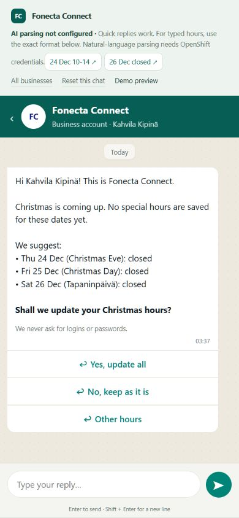
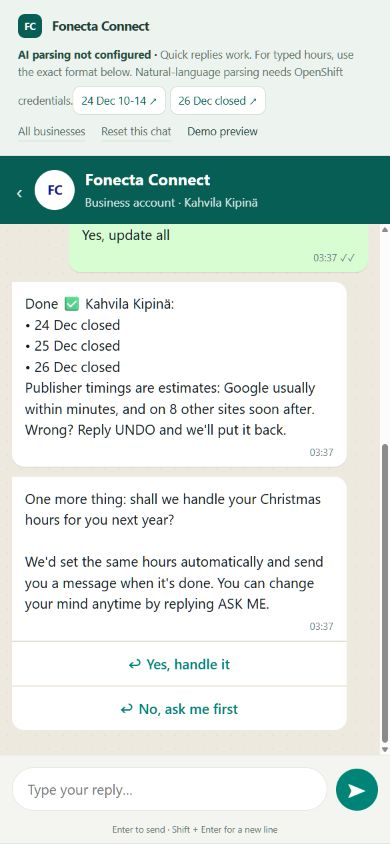
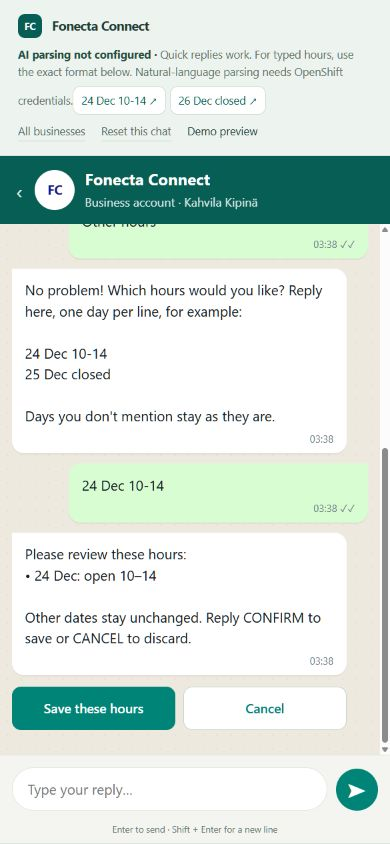
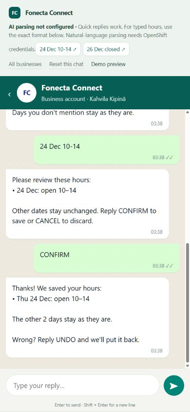
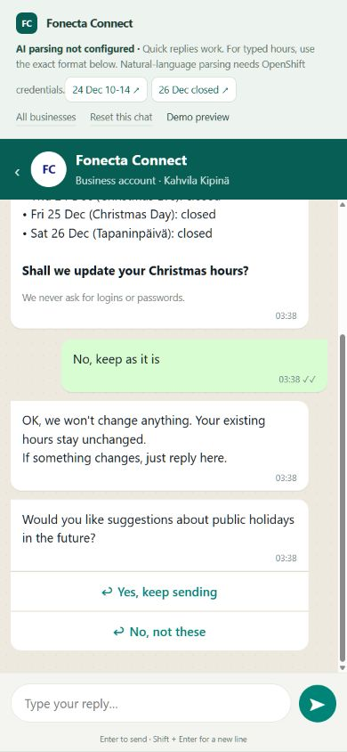
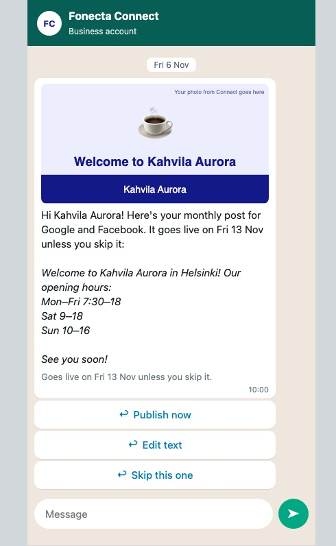
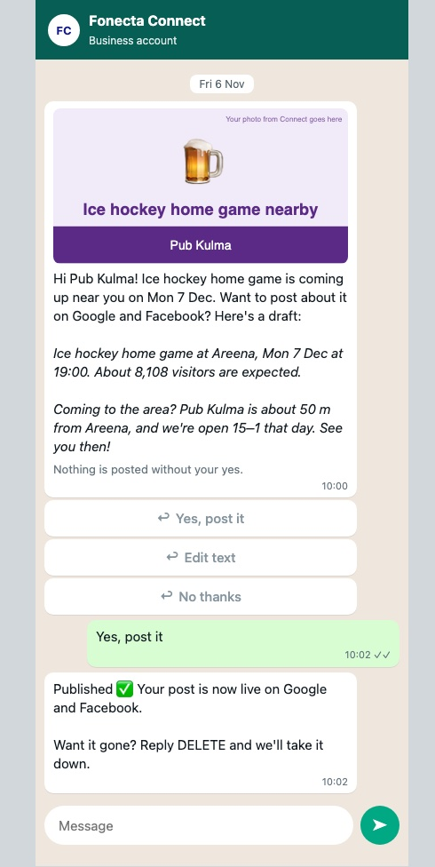
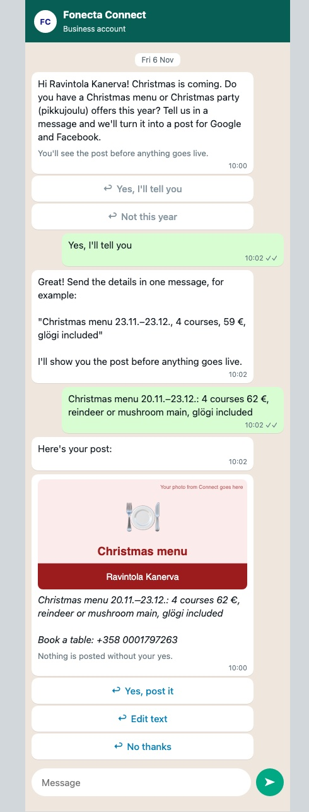
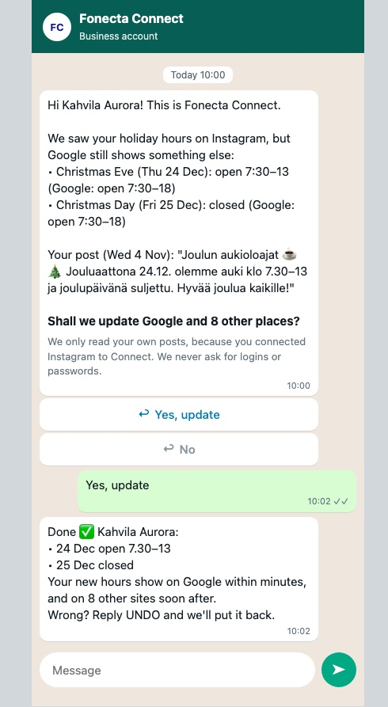
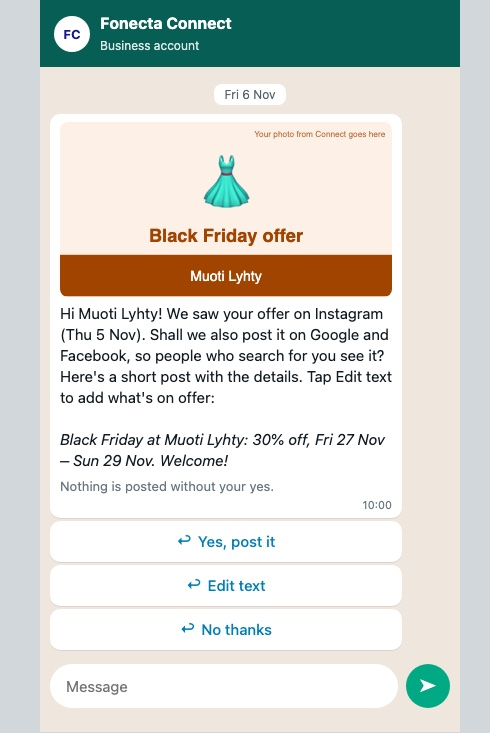

# Customer messages

What the owner sees on their phone. The screenshots are from the browser demonstration; exact message text follows below.

## 1. Opening hours (works in the demo)

| Proposal | Approval |
|---|---|
|  |  |

| Review the edit | Saved after confirmation |
|---|---|
|  |  |



- **Proposal:** a new customer gets all three Christmas days in one message, answered with WhatsApp's quick-reply buttons (the WhatsApp Business API has no polls).
- **Approval:** the confirmation and the "handle it next year?" question arrive in the same chat, right after the yes.
- **Edit:** the owner types "24 Dec 10-14" and reviews the draft. **Save these hours / CONFIRM** saves only that day; **Cancel** saves nothing. The other two days stay as they were.
- **Decline:** after a no, Connect asks once whether the owner wants this kind of suggestion in future, so it knows if they declined just this one or the whole kind.

## 2. Other ideas (examples, not working features yet)

The same loop beyond opening hours: Connect suggests, the owner approves in the chat. These screens are examples of where it could go next.

### Post suggestions

| Monthly post | Event post | Occasion post |
|---|---|---|
|  |  |  |

- **Monthly post:** Fonecta's existing monthly post as a WhatsApp preview instead of an email that needs a login; it goes live after 7 days unless the owner skips it.
- **Event post:** only for events that fit the business; nothing is posted without a yes, and *DELETE* takes it down.
- **Occasion post:** before Christmas, Mother's Day or another occasion, Connect asks what the business has planned (here: a Christmas menu), and the owner's own answer becomes the post, so nothing is invented.

### From the owner's own Instagram

| Holiday hours from Instagram | Campaign post from Instagram |
|---|---|
|  |  |

- **Holiday hours:** "You posted these Christmas hours on Instagram, but Google shows something else. Shall we update Google too?" One tap updates Google and 8 other sites.
- **Campaign post:** a Black Friday offer from Instagram becomes a short post written from the facts only (discount, dates), never a copy of the owner's post.

## Exact customer message text

**All messages are in English** (team decision), for owners in Finland, Sweden and Norway alike. Holiday names come from the challenge calendar and may appear in the local language. These are the exact messages from the current owner flow.

### Proposal with last year's hours: Kahvila Aurora

The owner set hours for this holiday last year, so the message shows them and offers the same again. The day with no history gets a suggestion, clearly labelled, in the same message. One message covers the whole New Year period.

```text
Hi Kahvila Aurora! This is Fonecta Connect.

New Year is coming up. No special hours are saved for these dates yet.

Last year you were open:
• New Year's Day: closed

We'd use the same hours this year.

For the other days we suggest:
• Wed 6 Jan (Loppiainen): 10–16

Shall we update your New Year hours?

We never ask for logins or passwords.
```

Buttons: **Yes, update all** · **No, keep as it is** · **Other hours**. After **Yes, update all**:

```text
Done ✅ Kahvila Aurora:
• 1 Jan closed
• 6 Jan open 10–16
Publisher timings are estimates: Google usually within minutes, and on 8 other sites soon after.
Wrong? Reply UNDO and we'll put it back.
```

Right after a yes, Connect asks once whether it may handle these hours every year (standing permission). A yes is saved; replying *ASK ME* takes it back at any time.

```text
One more thing: shall we handle your New Year hours for you next year?

We'd set the same hours automatically and send you a message when it's done. You can change your mind anytime by replying ASK ME.
```

Buttons: **Yes, handle it** · **No, ask me first**.

### Proposal for a new customer (no history): Kahvila Kipinä

A new customer has no history, so the message says "We suggest" and never claims "last year".

```text
Hi Kahvila Kipinä! This is Fonecta Connect.

Christmas is coming up. No special hours are saved for these dates yet.

We suggest:
• Thu 24 Dec (Christmas Eve): closed
• Fri 25 Dec (Christmas Day): closed
• Sat 26 Dec (Tapaninpäivä): closed

Shall we update your Christmas hours?

We never ask for logins or passwords.
```

Buttons: **Yes, update all** · **No, keep as it is** · **Other hours**.

### Approval follow-up

```text
Done ✅ Kahvila Kipinä:
• 24 Dec closed
• 25 Dec closed
• 26 Dec closed
Publisher timings are estimates: Google usually within minutes, and on 8 other sites soon after.
Wrong? Reply UNDO and we'll put it back.
```

### Edit draft: after `24 Dec 10-14`

```text
Please review these hours:
• 24 Dec: open 10–14

Other dates stay unchanged. Reply CONFIRM to save or CANCEL to discard.
```

Buttons: **Save these hours** · **Cancel**. Nothing is written until confirmation.

### Edit follow-up: after confirming the draft

```text
Thanks! We saved your hours:
• Thu 24 Dec: open 10–14

The other 2 days stay as they are.

Wrong? Reply UNDO and we'll put it back.
```

### Decline follow-up

```text
OK, we won't change anything. Your existing hours stay unchanged.
If something changes, just reply here.
```

Real WhatsApp uses the approved [template](../owner-page/whatsapp-template.json) with proposal references. Its confirmations report verified Yext sandbox writes; live publisher propagation has not been verified.
